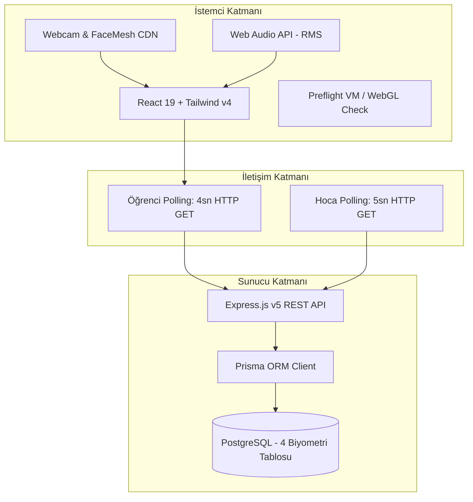

# 🦁 LEUKOLION v2.0 Mimari ve Güvenlik Teardown Raporu

**Proje:** LEUKOLION v2.0 (Yapay Zeka Destekli Uzaktan Sınav ve Gözetim Platformu)  
**Tarih:** Kasım 2026  
**Durum:** Yeni Çalışma Alanına Kopyalandı (`C:\Users\LENOVO\Desktop\leukolin_v2.0`)  
**PDF Rapor Konumu:** [LEUKOLION_V2_ANALIZ_VE_YOL_HARITASI_RAPORU.pdf](file:///C:/Users/LENOVO/Desktop/leukolin_v2.0/LEUKOLION_V2_ANALIZ_VE_YOL_HARITASI_RAPORU.pdf)

---

## 📌 Yönetici Özeti (Executive Summary)

Bu rapor, Harran Üniversitesi Sınav Merkezi için geliştirilen **LEUKOLION** çevrimiçi sınav ve gözetim platformunun kaynak kodlarını, biyometrik yapay zeka algoritmalarını ve sistem mimarisini ayrıntılı ve eleştirel bir yaklaşımla analiz eder.

Sistemde React 19, Express v5, PostgreSQL ve Prisma temelleri sağlam kurulmuş olmakla birlikte; **göz takibi doğruluğu**, **ağ mimarisi**, **sanal kamera açıkları** ve **5.000 eşzamanlı öğrenci yükü** altında ortaya çıkacak sunucu kilitlenmesi gibi kritik mühendislik darboğazları tespit edilmiştir. Proje, masaüstünde `leukolin_v2.0` dizini olarak klonlanmış olup dönüşüm adımları aşağıda planlanmıştır.

---

## 1. Sistemde Şu Anda Neler Var? (Mevcut Durum)



* **Frontend:** React 19 + TypeScript + TailwindCSS v4 tabanlı rol mimarisi (Admin, Akademisyen, Protokol, Öğrenci).
* **Biyometrik İzleme:** MediaPipe FaceMesh (CDN) ile 2B kafa/iris mesafeleri ve Web Audio API genlik ölçümü.
* **Preflight Kontrolü:** Sanal makine (VM) ve WebDriver kontrolü.
* **Backend:** Express v5, Prisma ORM, PostgreSQL, JWT ve MERNIS T.C. Kimlik doğrulama.
* **Canlı İzleme:** `LiveMonitor.tsx` üzerinden sınav oturumlarının telemetri takibi.

---

## 2. Neleri Eksik / Hatalı / Yanlış Yapmışız? (Derinlikli Teardown)

> [!CAUTION]
> **1. Sabit 2B Eşiklerle Göz ve Kafa Takibi Yanılgısı**  
> `ExamRoom.tsx` içerisinde kafa açısı burun-yanak mesafesiyle (`headRatio > 1.75`), göz hareketi ise iris-göz pınarı mesafesiyle (`irisPosition < 0.32`) hesaplanmaktadır. 720p bir web kamerasında göz genişliği sadece 20-30 pikseldir. Kalibrasyonsuz bu kurgu, öğrencinin gözlüğünden veya laptop açısının eğikliğinden ötürü **masum öğrencilere sürekli kopya cezası** keser.

> [!WARNING]
> **2. "Retina HUD" Terminoloji Çelişkisi**  
> Kodda ve arayüzde `[RETINA ODAK: NORMAL]` ifadesi yer almaktadır. Web kamerasıyla retina (göz arkası damar tabakası) taranamaz; takip edilen yapı **İris ve Göz Bebeğidir (Pupil)**. Bu adlandırma hem teknik ciddiyeti düşürmekte hem de KVKK kapsamında yersiz sağlık verisi endişesi yaratmaktadır.

> [!CAUTION]
> **3. HTTP Polling Faciası (WebSocket Yok!)**  
> Öğrenciler her 4 saniyede bir, gözetmenler ise her 5 saniyede bir veritabanına `GET` sorgusu atmaktadır. 5.000 öğrenci girdiğinde saniyede **1.250 ağır HTTP isteği** sunucuya biner; connection pool ve TCP soketleri tükenerek sistem 502 hatası verir.

> [!CAUTION]
> **4. 5.000 Kişilik Sınavda Fotoğraf Kaydı Çökmesi (I/O & Ağ Darboğazı)**  
> 3.000 öğrencinin şüpheli hareketinde saniyede 1.500 JPEG fotoğraf Node.js üzerinden veritabanına yazılmaya çalışılırsa **225 MB/sn (~1.8 Gbps)** trafik oluşur. Sunucunun kilitlenmesi kaçınılmazdır.

> [!WARNING]
> **5. Sanal Kamera (OBS/ManyCam) ve Çift Monitör Açığı**  
> Preflight aşamasında sanal kamera filtresi (`enumerateDevices()`) ve çift monitör denetimi (`window.screen.isExtended`) yapılmamıştır. Öğrenci sanal kameraya kayıtlı video verebilir veya ikinci monitör bağlayabilir.

> [!NOTE]
> **6. Galaksi/Gezegen Tabloları ve Şema Parçalanması**  
> `schema.prisma` dosyasında Harran Üniversitesi için `Galaxy -> System -> World` tabloları bulunmakta, biyometri için ise 4 ayrı tablo (`Face`, `Eye`, `Screen`, `Voice`) gereksiz JOIN maliyeti oluşturmaktadır.

---

## 3. PDF Raporundaki Önerilerin Gerçekçi Filtresi

| PDF'teki Öneri | Saha Gerçeği | Hüküm |
| :--- | :--- | :--- |
| **Tarayıcıda SmolVLM / WebLLM** | Eski öğrenci laptoplarında 2 GB ağırlık indirmek tarayıcıyı kilitler (OOM). | ❌ **İntihar (Uygulanamaz)** |
| **NVIDIA Maxine Entegrasyonu** | CUDA bağımlıdır; istemcide çalışmaz, sunucuda bütçeyi tüketir. | ❌ **Uygun Değil** |
| **Telemetriyi LLM ile Yorumlama** | Çok yavaş ve deterministik değildir. Yerine hafif State Machine / XGBoost gerekir. | ⚠️ **Aşırı Mühendislik** |
| **5 Noktalı Kalibrasyon & 3D SolvePnP** | Kişisel monitör sınırlarını çıkarır, 3D baş rotasyonunu derece cinsinden bulur. | ✅ **Doğru Endüstri Standardı** |

---

## 4. Mükemmel Ürüne Dönüşüm Yol Haritası (Adım Adım)

```mermaid
flowchart TD
    subgraph Client [İstemci - Tarayıcı (Sıfır Maliyet)]
        Calib[5 Noktalı Kişisel Kalibrasyon] --> MP[MediaPipe 3D Landmark]
        MP --> PnP[OpenCV.js SolvePnP Kafa Açısı]
        MP --> Fusion[Bileşik Bakış Vektörü]
        Fusion --> Filter[One Euro Filtresi]
        Filter --> Detect{4sn Boyunca Ekran Dışı?}
        Detect -- Evet --> Cooldown{Son 45sn içinde foto yüklendi mi?}
        Cooldown -- Hayır --> Snap[360p WebP Sıkıştırma 15 KB]
    end

    subgraph Cloud [Doğrudan Depolama]
        Snap --> Presigned[Presigned URL ile Cloudflare R2 / S3 Doğrudan Yükleme]
    end

    subgraph RealTime [Gerçek Zamanlı İletişim]
        Presigned --> Socket[Socket.io WebSocket Olayı: 150 Byte]
        Socket --> Server[Node.js / Express v5 Sunucu]
        Server --> AdminDash[Akademisyen LiveMonitor]
    end
```

1. **HTTP Polling -> WebSocket (Socket.io) Geçişi:** 4 saniyelik GET döngüleri kaldırılıp oda bazlı (room-based) anlık soket mimarisine geçilecek.
2. **5 Noktalı Kalibrasyon & OpenCV.js 3D SolvePnP:** Sabit 2B oranlar yerine kafa açısı derece cinsinden, göz odağı ise monitör sınırlarına göre hesaplanacak.
3. **Sanal Kamera & Çoklu Ekran Engellemesi:** `OBS Virtual Camera` etiketleri bloklanacak, `window.screen.isExtended` ile çift ekran kapatılacak.
4. **Presigned URL & 45s Cooldown Mimarisi:** Fotoğraflar Node.js'e uğramadan doğrudan S3/R2 nesne deposuna WebP (15 KB) olarak basılacak.
5. **Prisma Şema Sadeleştirmesi:** Galaksi/Gezegen modelleri tasfiye edilecek, biyometri tabloları tek bir `BiometricLog` altında toplanacak.
6. **"Retina" Terminolojisinin Tasfiyesi:** Arayüz ve kod "İris ve Bakış Açısı Analizi" standardına çekilecek.
